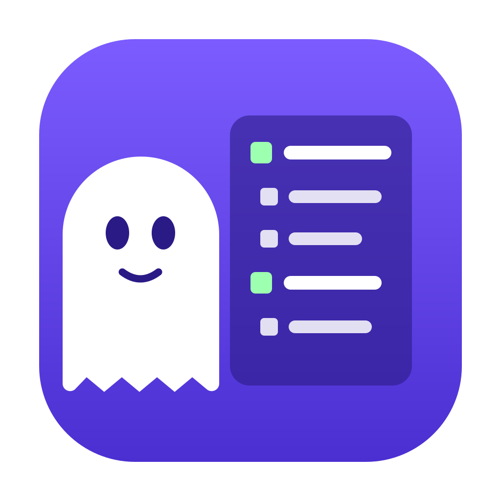

<p align="center"></p>

<h1 align="center">HD Fantasma</h1>

<p align="center"><b>Find files on your drives without plugging them in.</b><br>
<a href="README.md">Versão em português</a></p>

---

## What it is

If you work with video, photo, audio or design, you probably have a drawer full of hard drives, SSDs, USB sticks and cards. When you need "that client file", nobody remembers which disk it is on.

**HD Fantasma** ("ghost drive") makes a list of everything on each disk (names, sizes, dates and folders) and keeps it on your computer. Later you search that list **with the disk back in the drawer** and see which one holds the file.

<!-- Screenshots: not included yet. When they exist, put them in docs/img/ and show them here. -->

## What it does

- **Reads disks** (HDD, SSD, USB stick, card, internal disk, NAS) and stores the list in the catalog.
- **Two views:** columns (disks, folders, items) or a list.
- **Info panel** for each file or folder: name, type, size, dates and path.
- **Search across all disks at once**, with filters: type (video, image, audio, document, archive), size, date and chosen disks.
- **Browse absent disks:** an unplugged disk stays in the catalog and its folders can still be opened.
- **Finds duplicates:** files with the same name and size, on any disk.
- **Read again:** one button that rebuilds a disk's list after you changed it.
- **Export and import** one disk's catalog (`.hdfantasma` file) to send to someone else.
- **Works with Claude** (via MCP): ask "where is file X?" and Claude searches the catalog.
- Available in **Portuguese and English**.

## What it does NOT do (on purpose)

- **Never opens your files.** It only reads what the system reports: name, size, dates and folders. It does not look inside videos, photos or .zip files.
- **Never uses the internet.** It sends nothing to anyone, has no account and does not check for updates by itself.
- **Never writes to your disks.** It only reads. The catalog stays on your computer.
- **Cloud folders (Google Drive, Dropbox, iCloud):** only what is already downloaded on the Mac is cataloged. It never downloads anything from the cloud.

## Download and install (Mac)

1. Go to the project's [GitHub Releases](https://github.com/otavioclima-hub/hd-fantasma/releases) and download the newest **`.dmg`** file.
2. Double-click the `.dmg`; a window opens.
3. **Drag HD Fantasma into the Applications folder.**
4. Follow "First time you open it" below.

### First time you open it (macOS warning)

The app is **not signed by Apple** yet (signing is paid and done by companies). So macOS shows a warning the first time. The code is open source so you can check it. You only have to tell your Mac that you trust it, once.

**macOS 15 (Sequoia) or newer:**

1. Open HD Fantasma from Applications. A warning says the app could not be verified. Click **OK** (or **Done**).
2. Open the Apple menu (top-left of the screen) → **System Settings** → **Privacy & Security**.
3. Scroll to the bottom, where the message about "HD Fantasma" appears, and click **Open Anyway**.
4. Enter your Mac password (or use Touch ID) and confirm with **Open**.

From then on it opens normally.

**Older macOS (14 or earlier):**

1. In Applications, **right-click** (or Control-click) HD Fantasma and choose **Open**.
2. In the warning, click **Open** again.

## Where the catalog lives

On your Mac, at **Documents → HD Fantasma → `catalogo.sqlite`**. It is a single file; to back it up, copy that file.

## Use it with Claude

HD Fantasma can talk to Claude so you can ask things like "which videos over 2 GB do I have on my drives?". In short: open the app once and read a disk, then add HD Fantasma to the Claude Desktop (or Claude Code) settings. The full step-by-step, with text to copy, is in **[docs/MCP.md](docs/MCP.md)** (in Portuguese).

## FAQ

**Is there a Windows version?**
Coming soon. Mac comes first.

**My drive is formatted for Mac and I want to read it on Windows.**
Windows cannot read Mac formats by itself. Tools such as Paragon APFS/HFS+ for Windows add that. If Windows can see the disk, HD Fantasma can read it.

**Why doesn't the app update itself?**
Because it never uses the internet ([decision record](docs/adr/0015-app-sem-internet.md), in Portuguese). When a new version is out, download the new `.dmg` from Releases and drag it into Applications, replacing the old one. Your catalog is kept.

**Does it delete or change my files?**
No. It only reads name, size, dates and folders.

**What happens to a disk I unplug?**
It stays in the catalog, marked as absent. You can browse and search it as usual.

## For developers

- **Stack:** [Tauri 2](https://tauri.app) (Rust), SvelteKit + TypeScript UI, SQLite (FTS5) catalog.
- **Layout:** `crates/core` (library: database, disk reading, search, duplicates, export), `crates/mcp` (`hd-fantasma-mcp` executable), `src-tauri` (app), `src` (UI).
- **Run in development** (needs Rust and Node):

  ```bash
  npm install
  scripts/build-mcp-sidecar.sh   # Tauri requires the MCP binary to be built first
  npm run tauri dev
  ```

- **Tests:** `cargo test --workspace` and `npm run check`.
- **Build the Mac installer (universal, Apple Silicon + Intel):**

  ```bash
  scripts/build-release-mac.sh
  ```

  It builds the MCP (`scripts/build-mcp-sidecar.sh --universal`), runs `npm run tauri build -- --target universal-apple-darwin --bundles app,dmg` and checks that the `.app` contains both programs as universal binaries.
- **Third-party licenses:** `python3 scripts/gen-third-party-licenses.py` regenerates `THIRD_PARTY_LICENSES.md`.
- **Decisions:** [`docs/adr/`](docs/adr/) (Portuguese). **Vocabulary:** [`CONTEXT.md`](CONTEXT.md). **Plan:** [`PLANO.md`](PLANO.md).

## License and author

[MIT](LICENSE). Made by **Otavio Lima**. Third-party libraries are listed in [THIRD_PARTY_LICENSES.md](THIRD_PARTY_LICENSES.md).
