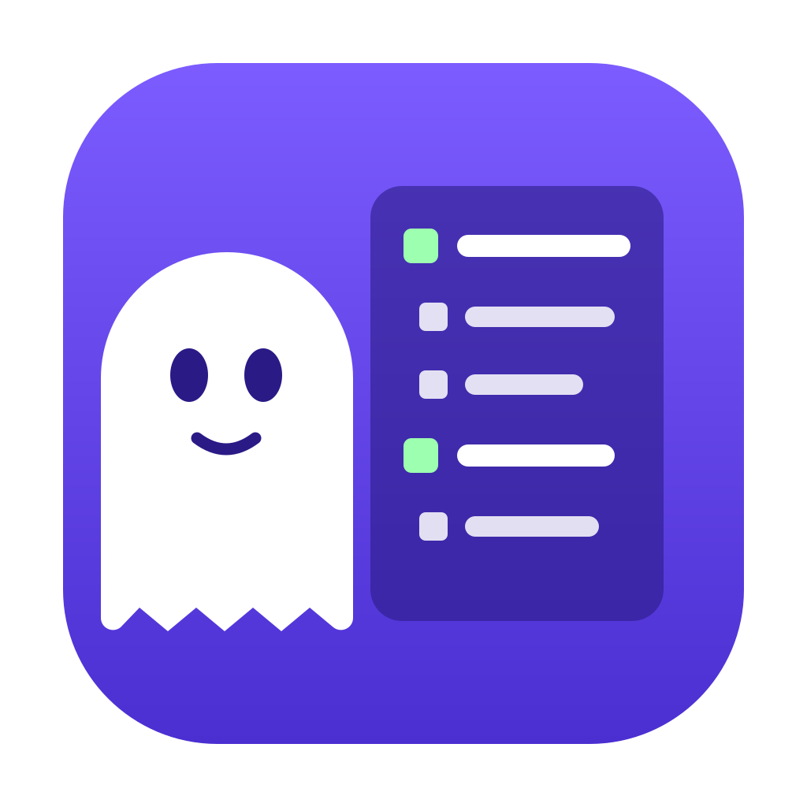

<p align="center"></p>

<h1 align="center">HD Fantasma</h1>

<p align="center"><b>Encontre arquivos nos seus HDs sem precisar plugá-los.</b><br>
<a href="README.en.md">English version</a></p>

---

## O que é

Quem trabalha com vídeo, foto, áudio e design acaba com uma gaveta cheia de HDs, SSDs, pen drives e cartões. Na hora de achar "aquele arquivo do cliente", ninguém lembra em qual disco ele está.

O **HD Fantasma** faz uma lista de tudo o que existe em cada disco (nomes, tamanhos, datas e pastas) e guarda no seu computador. Depois, você pesquisa nessa lista **com o disco guardado na gaveta** e descobre em qual deles o arquivo está. É como ter o "fantasma" de cada HD sempre à mão.

<!-- Capturas de tela: ainda não incluídas. Quando existirem, colocar em docs/img/ e mostrar aqui. -->

## O que ele faz

- **Lê discos** (HD, SSD, pen drive, cartão, disco interno, NAS) e guarda a lista no catálogo.
- **Mostra o catálogo de duas formas:** em colunas (discos, pastas e itens) ou em lista.
- **Painel de informações** de cada arquivo ou pasta: nome, tipo, tamanho, datas e caminho.
- **Busca em todos os discos de uma vez**, com filtros: tipo (vídeo, imagem, áudio, documento, compactado), tamanho, data e discos escolhidos.
- **Navega em disco ausente:** o disco desplugado continua aparecendo e dá para abrir as pastas dele.
- **Acha duplicados:** arquivos com o mesmo nome e o mesmo tamanho, em qualquer disco.
- **Ler de novo:** um botão que refaz a lista de um disco quando você mexeu nele.
- **Exportar e importar** o catálogo de um disco (arquivo `.hdfantasma`), para mandar a outra pessoa.
- **Funciona com o Claude** (via MCP): você pergunta em português, "onde está o arquivo X?", e o Claude consulta o catálogo.
- Em **português e inglês**.

## O que ele NÃO faz (de propósito)

- **Nunca abre os seus arquivos.** Só lê o que o sistema informa: nome, tamanho, datas e pastas. Não olha dentro de vídeos, fotos ou arquivos .zip.
- **Nunca usa a internet.** Não envia nada para ninguém, não tem conta e nem checa atualização sozinho.
- **Nunca escreve nos seus discos.** Ele só lê. O catálogo fica no seu computador.
- **Pastas de nuvem (Google Drive, Dropbox, iCloud, OneDrive):** entra só o que já está baixado no computador. Ele nunca baixa nada da nuvem.
- **No disco interno do Mac, pula o que não é seu:** as pastas do sistema, os dados internos de outros apps (`Library/Containers` e `Group Containers`) e o miolo das bibliotecas de Fotos, Música e TV (cada biblioteca aparece como um item só). Assim o macOS não fica pedindo autorização pasta por pasta.

## Baixar e instalar (Mac)

1. Abra a página de [Releases do projeto no GitHub](https://github.com/otavioclima-hub/hd-fantasma/releases) e baixe o arquivo **`.dmg`** da versão mais nova.
2. Dê dois cliques no `.dmg`. Vai abrir uma janela.
3. **Arraste o HD Fantasma para a pasta Aplicativos.**
4. Siga o passo "Primeira vez que abrir" abaixo.

### Primeira vez que abrir (aviso do macOS)

O app ainda **não é assinado pela Apple** (a assinatura é paga e feita por empresas). Por isso o Mac mostra um aviso na primeira vez. O app é seguro: o código é aberto, e dá para conferir tudo aqui. Você só precisa dizer ao Mac que confia nele, uma única vez.

**macOS 15 (Sequoia) ou mais novo:**

1. Abra o HD Fantasma pela pasta Aplicativos. Vai aparecer um aviso dizendo que o app não pôde ser verificado. Clique em **OK** (ou **Concluído**).
2. Abra o menu da maçã (canto superior esquerdo da tela) → **Ajustes do Sistema** → **Privacidade e Segurança**.
3. Role até a parte de baixo, onde aparece a mensagem sobre o "HD Fantasma", e clique em **Abrir Mesmo Assim**.
4. Digite sua senha do Mac (ou use o Touch ID) e confirme em **Abrir**.

Pronto: nas próximas vezes ele abre normalmente.

**macOS mais antigo (14 ou anterior):**

1. Na pasta Aplicativos, **clique com o botão direito** (ou Control + clique) no HD Fantasma e escolha **Abrir**.
2. No aviso, clique em **Abrir** de novo.

## Baixar e instalar (Windows, em teste)

A versão de Windows está em teste (beta), com as mesmas funções. Na página de [Releases](https://github.com/otavioclima-hub/hd-fantasma/releases), baixe o **`HD-Fantasma-…-windows-x64-setup.exe`** da versão marcada *Pre-release* e dê dois cliques. No aviso "O Windows protegeu o computador", clique em **Mais informações** → **Executar assim mesmo** (o app não é assinado pela Microsoft). Guia completo e lista do que testar: **[docs/WINDOWS.md](docs/WINDOWS.md)**.

## Primeiro uso

1. Plugue um disco (HD, SSD, pen drive, cartão) e clique em **Ler disco**, no topo do app.
2. Escolha o disco e espere a barra chegar a 100%. Pronto: ele já aparece na lista da esquerda, e você pode desplugar.
3. Para achar um arquivo, digite o nome na busca. Funciona com o disco plugado ou guardado na gaveta.

**Disco interno do Mac:** para ler o próprio disco do computador, o macOS exige o **Acesso Total ao Disco**. O app avisa e oferece o botão **Abrir Ajustes**: ative o HD Fantasma na lista (se ele não aparecer, clique em **+** e escolha o app em Aplicativos), depois feche e abra o app e leia de novo. Discos externos não precisam disso.

## Onde fica o catálogo

No Mac, em **Documentos → HD Fantasma → `catalogo.sqlite`**. No Windows, em `%LOCALAPPDATA%\HD Fantasma\catalogo.sqlite` (fora de Documentos, porque lá costuma ser o OneDrive). É um arquivo só. Para fazer cópia de segurança, copie esse arquivo.

Ele é pequeno: um HD de vídeos com alguns milhares de arquivos ocupa poucos MB; o disco interno inteiro de um Mac (quase 3 milhões de arquivos) fica em torno de 500 MB. Parado, o app usa cerca de 30 MB de memória.

## Usar com o Claude

O HD Fantasma pode conversar com o Claude, para você perguntar coisas como "onde está o arquivo do cliente X?" ou "quais vídeos com mais de 2 GB eu tenho nos meus HDs?". O Claude consulta o catálogo, mesmo com o disco desplugado.

1. Tenha o **Claude Desktop** e/ou o **Claude Code** instalado no Mac.
2. No HD Fantasma, clique em **Conectar ao Claude** (canto de cima). Leia o aviso de privacidade e confirme.
3. O botão passa a mostrar **Claude conectado**.
4. **Feche e abra o Claude Desktop** uma vez (no Claude Code, abra uma conversa nova). Depois é só perguntar.

Para desligar, clique no mesmo botão e escolha desconectar. Detalhes e o jeito manual, com os textos para copiar, estão em **[docs/MCP.md](docs/MCP.md)**.

## Perguntas frequentes

**Conectei ao Claude, mas ele diz que não acha o HD Fantasma.**
Confira se você já abriu o app uma vez pelo caminho "Abrir Mesmo Assim" (veja acima) e se fechou e abriu o Claude depois de conectar. Se ainda assim não funcionar, abra o app **Terminal**, cole a linha abaixo e aperte Enter. Ela só tira a marca de "baixado da internet" do app:

```bash
xattr -dr com.apple.quarantine "/Applications/HD Fantasma.app"
```

**Tem para Windows?**
Sim, em teste (beta): veja [docs/WINDOWS.md](docs/WINDOWS.md).

**Meu HD foi formatado no Mac e quero ler no Windows.**
O Windows não entende o formato do Mac sozinho. Existem programas que ensinam isso ao Windows, como o Paragon APFS/HFS+ for Windows. Se o Windows enxergar o disco, o HD Fantasma também lê.

**Por que o app não se atualiza sozinho?**
Porque ele não usa a internet de jeito nenhum (veja [a decisão](docs/adr/0015-app-sem-internet.md)). Quando sair uma versão nova, é só baixar o `.dmg` de novo na página de Releases e arrastar para Aplicativos, substituindo o antigo. O catálogo não se perde.

**Ele apaga ou muda meus arquivos?**
Não. Ele só lê nome, tamanho, datas e pastas.

**O que acontece com um disco que eu desplugo?**
Ele continua no catálogo, marcado como ausente. Dá para navegar e pesquisar nele normalmente.

## Para quem desenvolve

- **Tecnologias:** [Tauri 2](https://tauri.app) (Rust), SvelteKit + TypeScript nas telas, SQLite (com FTS5) para o catálogo.
- **Estrutura:** `crates/core` (biblioteca: banco, leitura de disco, busca, duplicados, exportação), `crates/mcp` (executável `hd-fantasma-mcp`), `src-tauri` (app), `src` (telas).
- **Rodar em desenvolvimento** (precisa de Rust e Node):

  ```bash
  npm install
  scripts/build-mcp-sidecar.sh   # o Tauri exige o MCP compilado antes
  npm run tauri dev
  ```

- **Testes:** `cargo test --workspace` e `npm run check`.
- **Gerar o instalador do Mac (universal, Apple Silicon + Intel):**

  ```bash
  scripts/build-release-mac.sh
  ```

  Ele compila o MCP (`scripts/build-mcp-sidecar.sh --universal`), roda `npm run tauri build -- --target universal-apple-darwin --bundles app,dmg`, confere que o `.app` tem os dois programas em formato universal e deixa **só o `.dmg`** em `instalador/` (nenhum `.app` fica na pasta do projeto). Com um certificado local chamado "HD Fantasma Local" nas Chaves, assina com ele, e o macOS mantém o Acesso Total ao Disco entre uma versão e outra.
- **Instalar no próprio Mac** a partir desse `.dmg` (vai para Aplicativos e confere que ficou idêntico): `scripts/install-mac.sh`.
- **Windows:** o GitHub Actions (`.github/workflows/windows.yml`) roda os testes e gera o instalador num Windows de verdade a cada envio. Veja [docs/WINDOWS.md](docs/WINDOWS.md).
- **Licenças de terceiros:** `python3 scripts/gen-third-party-licenses.py` refaz o `THIRD_PARTY_LICENSES.md`.
- **Decisões do projeto:** [`docs/adr/`](docs/adr/). **Vocabulário:** [`CONTEXT.md`](CONTEXT.md). **Plano:** [`PLANO.md`](PLANO.md).

## Licença e autor

[MIT](LICENSE). Feito por **Otavio Lima**. As bibliotecas de terceiros usadas estão listadas em [THIRD_PARTY_LICENSES.md](THIRD_PARTY_LICENSES.md).
